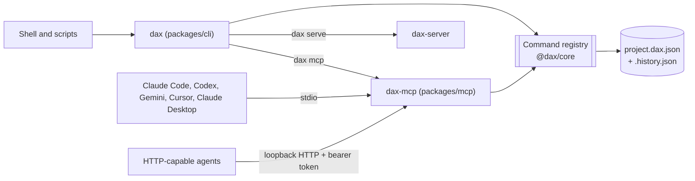

# CLI and MCP server

The live desktop host also provides `cancel_task` through the shared registry. Clients inspect `get_project` tasks, submit an explicit current-project task UUID and poll until cancellation completes. Finished/unknown work reports `cancelled: false`; completed edits remain in undo history. Standalone CLI/MCP hosts without a task controller explain the unavailable capability. Planning/read-only MCP excludes this non-read-only, irreversible command. Read-only inspection and cancellation bypass a long render's project-write lock; project mutations keep their existing serialization and revision guards.

Two of the three front doors are thin shells over the command registry in `@dax/core`. Neither has its own edit logic: they validate nothing themselves, they hand a command name and arguments to `tryRunCommand` and report the result. See the [architecture overview](overview.md) for the registry and the [MCP design research](../research/mcp-server-design.md) for the sources behind the security choices.

## Decision: in-process, one project file

Both front doors run the registry inside their own process and persist through core's `Session` to a `.dax.json` file (history beside it). They do not call the engine server. Reasons: the CLI must work with nothing else running, an MCP client that launches `dax-mcp` over stdio needs a self-contained process, and the file is already the shared truth. The cost is that the desktop app (which owns its project through `dax-server`) and a CLI or MCP process editing the same file at the same time do not see each other live; point them at the same file one at a time, or run MCP through the app later (a stdio shim that forwards to the server is the planned bridge, see research section 2.3).

## CLI (`dax`)

`dax commands`, `dax run <command> --json '{...}'`, `dax project new|show`, `dax import`, `dax cut` (`smart_cut`), `dax export` (`export_video`), `dax mcp`, `dax serve`. Exit codes: 0 ok, 1 command failed, 2 bad command line, 3 project file problem. `--json` prints one JSON document and nothing on stderr. Details and invariants: `packages/cli/AGENTS.md`.

## MCP server (`dax-mcp`)

- **Tools**: one per `commandTools()` entry (33 today) in registry order, plus `preview_frame`, which returns a JPEG still as MCP image content (main-track video only, no overlays). `readOnly` maps to `readOnlyHint`/`idempotentHint`, `irreversible` to `destructiveHint`. Failures return `isError: true` with core's message. Results are summary text plus compact data, and `structuredContent` with the same facts.
- **Resources**: `dax://project` (project JSON) and `dax://history` (the history tree).
- **Progress and cancellation**: `export_video` reports whole-percent `notifications/progress` when the client sends a progress token. Cancelling stops the wait; core cannot yet interrupt FFmpeg, so the render finishes and the server deletes the file it created.
- **Transports**: stdio (default) and Streamable HTTP on `127.0.0.1` or `::1` only. Each HTTP request must pass, in order, the Host check, the Origin check (when an Origin is sent) and `Authorization: Bearer <token>`. The token is 256 random bits per launch, delivered through `DAX_MCP_TOKEN`, an owner-only `--token-file`, or `--print-token`; it is never in the URL or the startup line by default. Loopback names on the listening port are always allowed, so passing an empty origin list cannot disable the check. No CORS headers are sent.
- **Safety options**: `allowedRoots` (checked after symlink resolution), `readOnly`, `allowIrreversible: false` (hides `export_video`), `commands` (an allow-list by name).
- **Concurrency**: editing commands run one at a time per session; all HTTP clients share one session.

## Not built yet

Draft-and-approve for external agents ([ADR 0006](../adr/0006-draft-approve-for-external-agents.md), still proposed): MCP tools edit the live session, credited as `ai` in the history and undoable. Also pagination, output schemas, resource subscriptions, and the sessionless 2026-07-28 protocol.

## Related

[Architecture overview](overview.md), [MCP design research](../research/mcp-server-design.md), [CLI sign-in bridges](../research/cli-subscription-bridges.md) (the Claude Code bridge will connect to this server).
