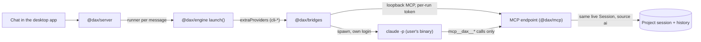

# CLI bridges

A bridge lets a chat message be answered by a command-line agent the user already has and has already signed in to, instead of an API key. The bridge spawns that official binary and lets it use its own login. dax never reads, copies, stores or forwards the login. The policy basis is [CLI subscription bridges](../research/cli-subscription-bridges.md); follow it exactly. The package is `packages/bridges` (`@dax/bridges`), see its [AGENTS.md](../../packages/bridges/AGENTS.md).

## Decisions

1. **The engine owns the live session.** The bridge does not open the project file. It starts an MCP HTTP endpoint from `@dax/mcp` (`startHttpServer`) with `session` set to the engine's own `Session`, on `127.0.0.1` only, with a fresh 256-bit token per run. Edits land in the same history the chat shows and are credited to `ai`. There is no second copy of the project.
2. **Only our tools.** `--tools ""` removes the built-in tools, `--strict-mcp-config` ignores every other MCP server, `--allowedTools mcp__dax__*` allows our server, `--disallowedTools` names the dangerous built-ins as a second lock, and `--permission-mode dontAsk` with `--permission-prompts none` means nothing can ask for approval. The exact command line is built by one pure function (`claude/command.ts`) and pinned by tests.
3. **Nothing sensitive on the command line or on disk.** The prompt goes to stdin. The MCP config file holds only `${DAX_MCP_TOKEN}`, and the token itself is in the child's environment. Both files are owner-only and removed when the run ends.
4. **A private, empty working folder.** The CLI runs in `<dataDir>/bridges/workspace`, never in the user's project. Without `--bare` it would load a project's `.mcp.json` and hooks.
5. **Environment allow-list.** The child gets only a short list of variables (`PATH`, `HOME`, config folders, proxies and certificate bundles). API keys and OAuth tokens are never copied. A stray `ANTHROPIC_API_KEY` therefore cannot silently change billing. The loopback address is always exempt from proxies.
6. **Detection is the CLI's own answer.** `claude --version`, `claude --help` (the flags it needs must be present, and the version must be at least 2.1.259) and `claude auth status` (exit 0 when signed in, and the non-secret `authMethod`). The bridge never opens `~/.claude` credential files or the keychain.
7. **Conversation continuity by `--resume`.** The CLI's session id is kept per project session object, so follow-up messages keep their context. If the CLI has lost the saved conversation, the run starts fresh without showing an error.
8. **Stream mapping.** The `stream-json` lines become `status`, `text`, `tool_call`, `tool_result`, `done` and `error` events. Tool results show our summary line, not the JSON envelope. Text is streamed from deltas and never duplicated. A `result` with `is_error` becomes a human message, with specific wording for sign-in problems, turn limits and budget limits.
9. **Fail closed.** If the CLI does not report our MCP server as `connected` in its init line, the run stops before the model can act without tools. A silent exit 0 is reported as a failure, not as success.
10. **Lifecycle.** Cancel sends SIGTERM to the CLI's process group, then SIGKILL after a grace period. Timeouts cover total time (30 minutes) and silence (10 minutes). The endpoint is closed, the run folder removed, and helper processes in the group killed. `launch()` closes the bridges with the server.

## Providers

| Provider | Status | Why |
|---|---|---|
| `cli-claude` | Ready when installed and signed in | Anthropic's compliance page allows an end user to sign in to the unmodified Claude Code binary with their own subscription. |
| `cli-codex` | Detection only: "not supported yet" | The MCP setup for a one-off run is not confirmed. The only confirmed route edits the user's `~/.codex/config.toml`, which we do not do. Planned: API-key first, subscription sign-in opt-in. |
| `cli-gemini` | Not supported, by decision | Google's terms forbid using third-party tools with consumer CLI sign-in, and the Gemini CLI stopped serving personal accounts on 2026-06-18. Use a Gemini API key through the OpenAI-compatible provider. |

The statuses (`not installed`, `not signed in`, `ready`, `unsupported`, `error`) appear in Settings with a next step, for example "Run `claude` once in a terminal to sign in". Checks are cached briefly and never block the Settings screen for more than 3.5 seconds.

## Tests

`pnpm --filter @dax/bridges test` runs against a fake `claude` executable (`packages/bridges/test/fixtures/fake-claude.mjs`). It really connects to the loopback endpoint and calls real tools on a real `Session`. One fixture is a trimmed copy of a recorded real Claude Code run. No network and no real CLI are needed. The tests cover detection states, the flags, event mapping, edits credited to `ai`, token hygiene, cancel, timeouts, resume, helper cleanup and shutdown.

On Windows, a test-only spawn adapter runs exact registered fake executable paths through Node, because Windows cannot execute Unix shebang fixtures. Production executable checks and spawning stay unchanged. Cancellation tests expect forced `taskkill` termination on Windows; POSIX signal-handler and mode-bit assertions remain platform-specific. These tests do not establish Windows ACL guarantees for arbitrary data folders.

## Related

[CLI and MCP server](cli-and-mcp.md) (the endpoint the bridge reuses), [architecture overview](overview.md), [CLI subscription bridges research](../research/cli-subscription-bridges.md).
