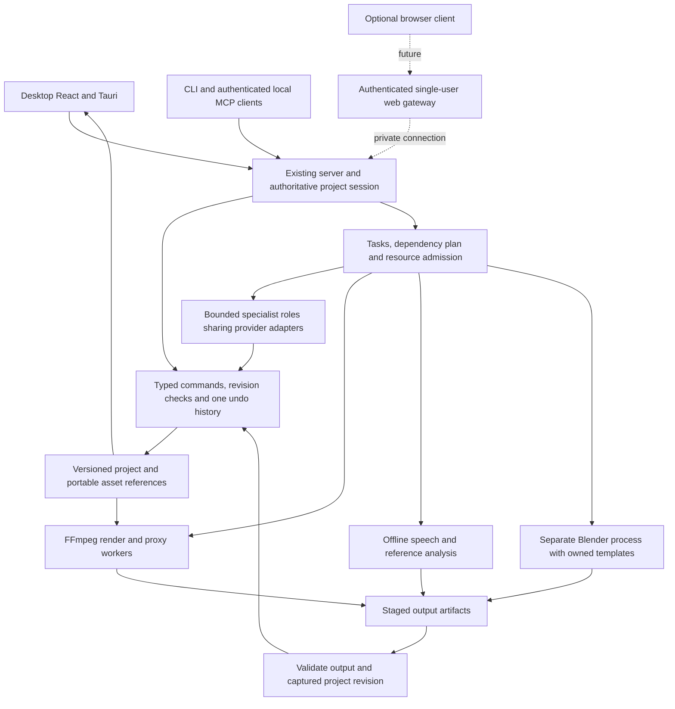

# Creator workflows: review and implementation plan

**Detailed execution handbook:** [master index](../implementation/2026-11-01-creator-editor/master-plan.md) expands these milestones into separate stage/step files with predecessor evidence gates and a future launch prompt. It remains planning-only until the owner starts implementation; the handbook's current continuation supersedes this document's historical branch pointer for execution setup.

Planning delivery: [issue #70](https://github.com/sahamo123/dax-editor/issues/70). Inspected baseline: `codex/impeccable-design-setup`, commit `2032f0d191aa46cb90dc29b76d002ce7dcb31451`. This extends Dax Editor; the supplied brief's empty repository fields are resolved by this checkout. It is a proposal, not implemented functionality or a release-readiness claim. No application execution, model calls, media edits or new dependency installation formed part of this review.

## Review

### Recommendation and evidence boundary

Keep the React/Tauri desktop, shared command registry, immutable edits, project revisions, task tracking and FFmpeg engine. Deliver a dependable creator editor in increments. The principal new investment is a layered composition model and matching preview/export path; changing the chat UI or adding more agents cannot substitute for it.

Freshly inspected: source files linked below, package rules, current handoff, existing research and open GitHub issue/PR metadata. [PR #69](https://github.com/sahamo123/dax-editor/pull/69) is open/unmerged; default `main` is not this application baseline. The architecture overview and several package AGENTS maps contain historical feature-absence statements contradicted by current source. Preserve their invariants, but reconcile their status descriptions in M0.

Recorded evidence, **not rerun here**: November 1 `pnpm check` passed 1,799 package and 17 root tests, with 67 explicit skips (`artifacts/impeccable-setup-final-check.log`, tail inspected). October 27 records 39 browser workflows, actual MCP transport edits/export, offline AI edits, speech and hosted-runner native acceptance. These establish only the recorded scenarios. Owner-laptop native execution, cross-version upgrade, actual external-assistant sessions, hosted-provider live calls, hours-long media and peak memory still need their own checks. See [STATUS](../STATUS.md) and [continuation](../engineering/laptop-continuation.md).

Visual evidence inspected: October 22 screenshots `artifacts/functional-audit/final/current-workspace.png` and `current-tools.png`, compared with current Shell/CSS source. They show a compact chat/preview/timeline layout and an overlay tools drawer. They are historical captures, not a fresh visual/accessibility audit. Impeccable manual-context Operate/shape guidance informs the proposed workflow; its launcher, detector, hooks and formal critique pipeline were not run. PRODUCT.md and DESIGN.md are absent; no approved replacement visual identity is assumed.

### Current components, gaps and concrete improvements

| Area | Inspected implementation and evidence | Gap / proposed action |
|---|---|---|
| Shared editing engine | [commands](../../packages/core/src/commands.ts), [session](../../packages/core/src/session.ts), [live engine](../../packages/server/src/engine.ts): typed commands, pure edits, revision guards, history and atomic saves | Retain. New operations must work through manual, AI and MCP entry points; require revision checks at the final commit of every long job. |
| Timeline/compositing | [schema](../../packages/core/src/schema.ts), [render](../../packages/core/src/render.ts): gapless `v1`, free audio, separate text/images/zoom/captions; render order is fixed | No general video layers, B-roll/PiP, arbitrary ordering, masks or multicamera model. Add bounded video/still layers and a versioned composition contract before advanced creator features. |
| Preview/export | [PreviewPane](../../apps/desktop/src/editor/preview/PreviewPane.tsx), [RenderedReview](../../apps/desktop/src/editor/preview/RenderedReview.tsx): interactive proxy playback and revision-bound rendered review | Interactive approximation and final composition can differ. Every new effect needs declared preview coverage and golden-frame/audio checks; review render remains authoritative. |
| Content types | [templates](../../packages/core/src/templates.ts), [34 recipes](../../templates/README.md): format, cleanup, text and some effects are deterministic | No first-class Short/Full-length/Podcast/Educational profile, default-style selection, brand overrides or persistent chosen profile. Add data profiles, not four separate editors. |
| Template truthfulness | `templates.ts` still lists captions as unavailable; [podcast recipe](../../templates/styles/podcast-clip-audiogram.json) says captions are unavailable despite current speech/caption commands | Reconcile capability metadata against installed runtime and implemented template steps. Templates can remain incomplete even when a low-level command exists. Show applied/skipped steps before claiming a finished recipe. |
| UI/control panel | [Shell](../../apps/desktop/src/app/layout/Shell.tsx), [ProjectTools](../../apps/desktop/src/app/layout/ProjectTools.tsx), [workspace CSS](../../apps/desktop/src/app/styles/workspace.css), [tokens](../../apps/desktop/src/app/styles/tokens.css) | Preserve resizers, dark/Inter identity and keyboard controls. The compact drawer covers editing content; unrelated controls compete in one tab group; no content-profile/reference-style/character workflow. Split project setup from contextual selection controls. |
| Chat/tasks | [ChatPanel](../../apps/desktop/src/app/chat/ChatPanel.tsx), [TaskQueue](../../apps/desktop/src/app/chat/TaskQueue.tsx), [task store](../../packages/server/src/tasks.ts) | Queue/steer/Stop/restart interruption exist. Add parent/child workflow tasks, dependency and artifact links, explicit blocked states and safe retry semantics. The current recent-task JSON store is not a durable distributed job queue. |
| AI/MCP | [agent loop](../../packages/agent/src/agent.ts), [tool selection](../../packages/agent/src/tools.ts), [live MCP](../../packages/server/src/live-mcp.ts) | Reuse providers and tool budgets. Add bounded specialist roles; do not create a model process per role. Actual client-specific and paid-provider verification remains separate from protocol/mock tests. |
| Speech/long-form | [captions](../../packages/core/src/captions.ts), [cuts](../../packages/core/src/cuts.ts), [speech panel](../../apps/desktop/src/app/layout/SpeechPanel.tsx) | Transcription/correction/reviewed cuts exist. Chapters, speaker labels/diarization, synchronized multiple recordings, semantic highlight selection and hours-long UX are not established. Basic single-camera podcasts should ship first. |
| Blender | [motion contract](../../packages/core/src/motion.ts), [adapter](../../packages/engine/src/blender.ts), [owned script](../../packages/core/assets/blender/template.py) | Three bounded templates, not a character creator. Current output is opaque MP4, capped at 10 seconds and 1920x1080. Characters need curated rigs, asset provenance, poses/animations, preview, recipes and alpha composition. |
| Ingestion/hosting | [connector](../../packages/core/src/connector.ts), [server](../../packages/server/src/server.ts), [security](../../packages/server/src/security.ts) | Local connector and loopback API exist. No built-in YouTube/style pipeline or production remote identity/tenant boundary. The chat application's Drive connector is not an integrated Dax Drive connector. |
| Reliability/delivery | [media pipeline](../../packages/server/src/media-pipeline.ts), [history](../../packages/core/src/session.ts), [CI](../../.github/workflows/ci.yml), [native acceptance](../../.github/workflows/native-windows-acceptance.yml) | Existing proxy/derived concurrency limits and history pruning help, but do not prove bounded whole-app memory. Extend resource accounting and acceptance; retain unsigned-binary policy blocker as machine-specific, not a reason to weaken Windows security. |

### Proposed control-panel experience

Primary journey: **Choose project type → import → choose/default style → inspect suggested plan → edit → review → export**. Existing projects open directly in the editor. Setup is skippable; manual editing never waits for an LLM. Use a setup panel, not repeated modal prompts.

```text
Project / Save / Undo / Redo             Active work + queue             Export
Assistant & plan        Preview / comparison              Contextual inspector
Provider, mode          Playback / review coverage        Selected clip or layer
Attachments             Timecode / safe-area guides       Properties / regenerate
Queue / Steer / Stop     Persistent timeline spanning the editing area
Media | Templates | Style | Captions | Characters         Task detail / history
```

The diagram is information architecture, not an approved pixel mockup. Keep the assistant collapsible and the preview usable while inspecting. At narrow widths, use an explicit Edit/Assistant switch and a resizable bottom inspector; do not leave the preview permanently covered. Task state remains accessible in either view. Selecting a clip must not move keyboard focus unexpectedly. Drawers/dialogs restore focus, support Escape and never clip their primary action.

| Profile | Initial proposed defaults, all editable | Specialized controls |
|---|---|---|
| Short | 9:16, 1080x1920; target 30-60 seconds; bold captions when transcript exists; restrained punch-ins | Hook/title, caption safe area, music/ducking, output variants |
| Full-length | 16:9, 1080p; preserve source frame rate where supported; gentle cleanup; sparse titles | Chapters, B-roll, transcript navigation, markers |
| Podcast | 16:9 for full episode; separate short-clip preset; speech-first mix; conservative cuts | Speaker labels, source sync, split-screen after M3, reviewed highlights |
| Educational | 16:9, readable chapter titles/callouts; preserve meaningful pauses | Slides/stills, PiP instructor, step markers, optional character scenes |

Applying a profile to an existing project must show its proposed change set; it must not silently trim, overwrite format or restyle manual edits. Precedence: explicit item override → project override → pinned profile/template defaults. Offer an explicit reset, preserve template versions and report unsupported steps.

Accessibility acceptance: keyboard-complete import/edit/export; visible focus; measured contrast; text labels for essential controls; non-color-only task states; reduced motion; screen-reader task announcements without progress spam. Verify 1366x768, 1440x900 and 1920x1080, plus real Windows 100/125/150/200% scaling. These are targets, not claims that current screenshots passed them. SEO is irrelevant to the authenticated editing surface; any public marketing site is separate.

## Architecture Feasibility

### Preserve one session owner and extend its workers



Solid lines include proposed extensions to existing modules; dotted lines are future hosting. Workers produce artifacts or typed proposals. Only the session owner commits them. Keep planning, analysis and rendering outside the short mutation lock; commit with expected project/revision, reject stale results, and leave a recoverable artifact instead of overwriting intervening edits.

### Data model and compatibility

| Proposed contract | Minimum fields / behavior | Owning module |
|---|---|---|
| ContentProfile / StyleRecipe | Version, content type, output defaults, caption/title/audio treatment, cut policy, required capabilities; no code or absolute paths | Core schemas; JSON data under `templates/profiles` |
| Composition layers | Stable id, kind, timeline range, source range, stack order, transform, crop, opacity, blend/alpha convention, mute/visibility and anchoring | Core schema/pure edits/render; UI consumes protocol summaries |
| ReferenceAnalysis | Asset digest, sample ranges, measured features, inferred features, confidence, unknowns, analyzer version and provenance | Core contract; injected engine analyzer |
| EditPlan | Base project/revision, bounded typed operations, explanations, required assets/capabilities and validation results | Core planner; agent proposes, engine validates/commits |
| CharacterRecipe | Template/rig version, verified asset ids/digests, parameter values, pose/action, duration/fps/seed, output metadata | Core motion contract; Blender adapter |
| WorkflowTask | Existing task fields plus workflow/parent/dependency ids, captured settings/mode/revision, resource class, input digest, attempt, output references and failure category | Protocol/server; no credentials in task payload |
| Portable asset reference | Stable asset id/content digest, workspace-relative or managed object reference, provenance and original-name display; private path mapping outside portable project | Core persistence + server resolver |

Current `ProjectSchema` accepts only `version: 1` and requires absolute local asset paths. Introduce an explicit v1 reader/migration and v2 writer before saving new fields. Back up originals; migrate every persisted history/checkpoint state, not only the current timeline. Validate first, write atomically, reject unknown future versions, and never let an older build silently strip new layers. Offer legacy export only when a project uses compatible features; otherwise explain the incompatibility.

Retain seconds as the public API unit and existing frame-grid rules, including fractional frame rates. Centralize source↔timeline mapping before speed changes, transitions or synchronized cameras. Keep `v1` gapless initially; add free-positioned upper layers. Specify ripple versus fixed anchoring per element so trims/reorders update dependent captions, B-roll, masks and keyframes predictably. Each batch remains one undo entry.

“Behind the person” requires **original footage + text layer + synchronized foreground matte**, not simply moving text below an opaque video. M3 supplies layers/alpha; automatic segmentation is a separately measured extension. Begin with user-supplied cutouts/mattes and deterministic compositing. Do not promise automatic clean hair/occlusion handling before model/license and temporal-quality evaluation.

### Reference video and YouTube style analysis

Feasible first version: accept an authorized local reference video, retain an optional YouTube attribution link, analyze a bounded excerpt, and generate an editable style recipe. A link or transcript alone cannot reveal actual typography, shot layout, motion or visual transitions. The existing text-only local model is suitable for routing; it does not see footage. Use deterministic media analysis first, optional licensed OCR/vision later, and user corrections for uncertain features.

Pipeline: resolve authorized source → probe/digest → sample frames and audio → estimate cuts/shot durations, aspect/framing, text placement/density, palette and audio energy → combine transcript-derived structure → draft recipe with evidence timestamps/confidence → preview on the user's own footage → commit supported operations. Analyze reference assets separately from project edits. Repeated analysis can reuse a cache keyed by source digest, sample policy and analyzer version; deleting the source invalidates its cache.

Do not implement a universal YouTube downloader as the default. Google's API policies restrict downloading/caching audiovisual content without prior approval; the caption-download API requires permission to edit the video. Use an official allowed metadata/embed path for links, or the user's original/exported video for full analysis. Rights to the footage and permission to acquire it via a platform are separate checks. Sources: [YouTube API policies](https://developers.google.com/youtube/terms/developer-policies), [caption download](https://developers.google.com/youtube/data/reference/rest/v3/captions/download).

Call the feature **Reference style**, not “exact clone.” Reproduce generic editing parameters, not copyrighted source clips, music, scripts or identity assets. Display unsupported/low-confidence features instead of invented detections. No extractor, OCR package or vision model is selected for installation in this plan; M5 starts with a bounded spike and intake evidence.

### Blender characters and reusable templates

Build a character configurator around a small set of owned/permissively licensed rigged characters: appearance parameters, materials, camera, lighting, poses, a few gestures and reusable scene presets. Persist parameters for regeneration. Users can still edit their own models in Blender outside Dax. Arbitrary text-to-3D, sculpting, automatic rigging, realistic likeness and lip-sync are later research, not consequences of having Blender installed.

Reuse the separate-process adapter; do not embed Blender into the UI. Accept template ids and validated asset references only. Retain factory startup, disabled auto-execution and owned scripts. The adapter already has a 30-minute render timer: strengthen timeout/error classification, output/disk bounds, explicit Python failure reporting, killed-child cleanup and version compatibility tests. Disabling scene auto-execution is not a Python sandbox: application scripts still need review, and hosted workers need OS/container restrictions. Relevant official command/security references: [Blender arguments](https://docs.blender.org/manual/en/4.5/advanced/command_line/arguments.html), [scripting security](https://docs.blender.org/manual/en/4.5/advanced/scripting/security.html). Full pages were unavailable to the research fetch; command flags were checked in the current adapter and official indexed documentation.

Start with a flattened character scene as an ordinary video; after M3, add transparent renders through a verified alpha-preserving intermediate. Current MP4 output is not that intermediate. Define premultiplied/straight-alpha conversion and test edges over light/dark footage. Pin/hash rigs, textures and animation packs, retain asset licences separately from Blender's licence, and record renderer/template versions in generated metadata. Benchmark a low-resolution draft before full-resolution rendering. Blender stays optional and is released after each job.

### Specialized agents and resource control

Use existing provider adapters and a deterministic workflow coordinator. “Agent” describes a bounded responsibility; most operations should be ordinary jobs, not additional LLM conversations.

| Role | Input → result | Allowed actions |
|---|---|---|
| Planner | Brief + compact project summary → EditPlan | Read-only inspection; no project writes in Planning |
| Media analyst | Authorized excerpt → measured features/transcript | Read staged media; no shell/network tools exposed to models |
| Editor | Valid plan + current revision → grouped edit | Allowlisted reversible commands through the session owner |
| Motion specialist | Character/template parameters → generated asset | Typed motion job only; no generated Python |
| Reviewer | Render sample + intended changes → findings | Read-only technical checks; optional vision, human visual sign-off |
| Export worker | Captured project snapshot + preset → decoded export | Controlled render job and owned output path |

Initially run one inference request and one heavy render/speech/analysis job at a time on the laptop. Proxy, thumbnail and background work must also participate in admission control; current per-pipeline limits are not a whole-app RAM budget. Prefer preview responsiveness; pause background work at safe boundaries, unload idle models, and expose queued/resource-wait states. Allow independent read-only analysis concurrency only after measuring CPU/GPU/memory, not because several agents exist.

Journal workflow transitions and idempotency keys before dispatch. Recover interrupted jobs as interrupted; retry read-only/idempotent work explicitly, never replay a possibly committed edit blindly. Deduplicate completed mutations by operation id and recorded revision. Reuse the current task store for an initial bounded local workflow journal; adopt SQLite/another durable store only if measured volume or atomicity requirements justify it, with an ADR and migration. No Redis, broker or generic agent framework is needed for the desktop milestone.

[OpenClaw's gateway](https://docs.openclaw.ai/concepts/architecture) demonstrates one owner with typed clients/events; [Hermes MCP](https://hermes-agent.nousresearch.com/docs/user-guide/features/mcp) documents connecting to external tools. Use these as architectural references and optional external clients, not mandatory embedded runtimes. This is an integration recommendation, not a verified Dax interoperability claim. Reusing any code still requires pinned licence/security intake; no new framework is proposed.

### Hosting, security and scalability

| Deployment | Proposed boundary | Readiness / trade-off |
|---|---|---|
| Desktop | Existing Tauri + local engine, local media, optional local model | First release; lowest operational cost and supports offline editing |
| Personal headless host | Same engine and browser UI; private-network access; persistent workspace volume; one authenticated owner | Feasible next. Containerize controlled media workers, provide backup/restore and authenticated upload/download. Remote computation requires transferring media. |
| Public single-user endpoint | TLS/auth gateway with revocable sessions, upload limits, quotas, redacted audit, websocket/origin/CSRF protection | Separate security/operations gate; not achieved by changing `127.0.0.1` to `0.0.0.0` |
| Multi-user service | Identity/tenant authorization, isolated workers, durable queue, object storage, shared DB, quotas and backup policy | Later product scope; no current tenant isolation or collaboration model. Scale workers across projects; keep one ordered writer per project. |

Keep the engine on a private interface; the gateway terminates remote identity and owns an engine credential inaccessible to browser code. Scope every media range request, task, project and export to the authenticated workspace. Browser clients use upload ids/download handles, never server filesystem paths. Preserve the desktop token/Host/Origin gates. Test remote and desktop trust policies separately; no wildcard CORS or disabled origin checks.

Restrict URL ingestion against SSRF, redirects to private addresses, DNS changes, protocol tricks and excessive sizes/durations. Verify input formats; isolate native decoders/Blender with no unnecessary network, bounded CPU/RAM/disk/time and scoped writable directories. Keep provider keys outside project files and downloadable job logs. Explicitly show what frames/transcripts would leave the device for optional hosted analysis. Keep local-only behavior possible.

Performance work: reuse existing proxies; tile long waveforms/filmstrips and virtualize timeline/transcript views; bound decode queues and cache by bytes; avoid rebroadcasting giant project snapshots unnecessarily; measure history memory despite existing pruning. Add incremental render caching only after invalidation keys include source digest, composition, fonts, renderer and profile versions. A hosted upload at 20 Mb/s of 10 GB takes roughly 67 minutes before overhead: hosting shifts computation, it does not remove data-transfer cost.

## Implementation Roadmap

### Milestones, owners and gates

Effort is estimated **engineering person-days**, including implementation tests and review fixes; it is not elapsed agent runtime. Role names are proposed owners, not assigned people. Preserve existing issues for unfinished release work; use #70 for this planning delivery and create scoped implementation issues from these milestones only when execution starts. Split each milestone into roughly 1-3-day PRs, usually under 400 changed lines. Record new architecture decisions before implementation.

| ID / priority | Deliverable and proposed owner | Effort | Dependencies | Verification / exit gate |
|---|---|---:|---|---|
| M0 / P0 | Baseline reconciliation and acceptance fixtures; release engineer + QA. Reconcile stale docs/template claims and existing [#9](https://github.com/sahamo123/dax-editor/issues/9), [#17](https://github.com/sahamo123/dax-editor/issues/17). | 2-4 | Current branch | Clean source checks, fresh visual walkthrough; manual offline edit/export; honest owner-native blocker; licensed short, long, podcast, tutorial fixtures and saved receipts. |
| M1 / P0 | Control-panel workflow and design-system documentation; UI engineer + designer, extending [#13](https://github.com/sahamo123/dax-editor/issues/13). | 4-7 | M0 | Before/after evidence for empty/import/edit/error/export; keyboard and real DPI checks; chat/preview/inspector usable together; queue/steer/Stop preserved. |
| M2 / P1 | Four content profiles, capability-driven template gallery, project overrides and project-format migration foundation; core/UI engineer, extending [#12](https://github.com/sahamo123/dax-editor/issues/12). | 4-6 | M0; M1 for UI | Deterministic no-LLM application, old-project/history round trip, one undo, no lost overrides, unavailable steps reported; four sample exports. |
| M3 / P1 | Bounded layers, still scenes, transforms/keyframes, basic transitions, alpha, PiP and matching review; media engineer + UI engineer. | 10-16 | M2 migration | ADR for composition; layer-order/opacity/overlap/ripple/transition tests, fractional-fps A/V sync, preview/export comparisons, undo/save/reopen; text behind a supplied matte. |
| M4 / P1 | Long-form and podcast/educational workflow; media/UI engineer + QA, extending [#14](https://github.com/sahamo123/dax-editor/issues/14). | 8-14 | M3 | Chapters/markers, still/slide scenes, manual camera sync/switch, transcript navigation and reviewed highlights; real 30/60/120-minute fixtures, VFR, separate audio, seek/cut/export without drift. Diarization remains optional if not yet qualified. |
| M5 / P2 | Reference-style analyzer and editable recipe; media/AI engineer. Begin with 2-day feasibility spike inside this estimate. | 7-12 | M2; M3 for advanced styles | Local authorized reference → evidence/confidence recipe → preview → apply/undo; unavailable URL/unsupported style handled; deterministic checks plus human comparison across held-out references. |
| M6 / P2 | Curated Blender character configurator and scene packs; graphics engineer + technical artist, extending [#16](https://github.com/sahamo123/dax-editor/issues/16). | 10-18 | M2; M3 for alpha | Three curated character/scene examples; change appearance/action → draft/full render → import → regenerate → undo; alpha edges, failure, timeout/cancel, provenance and no stray child processes. |
| M7 / P2 | Bounded specialist workflows, resource admission, durable recovery; server/AI engineer, extending [#10](https://github.com/sahamo123/dax-editor/issues/10), [#15](https://github.com/sahamo123/dax-editor/issues/15). | 5-8 | M2; integrate M4-M6 as available | Parent/child traceability, no duplicate mutation on restart/retry, conflicting manual edits preserved, Planning immutable, actual client sessions, bounded resources and non-cancelling steering. |
| M8 / P3 | Personal self-hosted deployment and gateway; DevOps/security engineer. Start with private single-user access. | 8-14 | M2 migration; M7 | Threat-model ADR and portable-asset resolver, auth/range/upload isolation, reconnect, quotas, cancellation, restart and backup/restore; no host paths/secrets exposed; same projects export on desktop/host. |
| M9 / P0 gate | Final compatibility, performance and distribution; release engineer + QA. Work incrementally, close after applicable milestones. | 6-10 | Selected release milestones | Full source/browser/native suite, offline clean install, cross-version upgrade, uninstall preserves projects, supported-codec full decode, resource/leak results, provenance/checksums/handoff. |

M0-M2 form the first useful improvement release: **10-17 person-days**, approximately 2-4 working weeks for one experienced developer with design/QA availability. The complete bounded M0-M9 scope totals **64-109 engineering person-days** before contingency, plus roughly **5-10 technical-artist days** for licensed character/animation preparation. Reserve 30% for unknown media/platform failures: about **83-142 engineering days**. A two-engineer team with part-time designer/artist/QA could plan roughly **10-16 calendar weeks**, subject to the M3 dependency chain and external native/credential gates; this is an estimate, not a commitment. A solo developer should plan roughly 17-29 working weeks with that buffer.

Critical path: M0 → M2 → M3 → M4/M6 → M9. UI design and reference-feature research can overlap; final M5/M6 integration cannot bypass M3. M7 infrastructure can begin after M2 and accept later adapters. M8 is optional for the desktop release. Specialist agents do not justify discounting rendering, migration or native validation effort.

### Explicit later scope and research gates

- Automatic person matting/reframing: 2-3-day spike, then provisional 5-10 engineering days if a licensed model meets temporal-quality/resource gates. Ship manual mattes first. This is additional to M0-M9.
- Automatic speaker diarization/sync, generated audiograms and highlight ranking: begin with manual labels/sync and deterministic layouts in M4; qualify models on overlapping/noisy speech before claiming automation.
- Arbitrary text-to-3D, automatic rigging/lip-sync, full scene authoring and likeness/voice generation: require a separate spec, asset/model intake and measured prototype; no credible production estimate yet. Curated configurable characters satisfy the bounded first release.
- Public multi-tenant hosting, collaborative editing/CRDTs, a plugin marketplace, mobile editing, HDR/4K professional finishing and unrestricted generative video are separate programs. The existing [experimental macOS issue #39](https://github.com/sahamo123/dax-editor/issues/39) remains separate from Windows-first readiness.

### Resources and test strategy

Provisional development target: Windows 11 x64, recent 6-8-core CPU, **16 GB RAM baseline and 32 GB preferred**, SSD with room for originals/proxies/renders. These are planning budgets, not measured supported minimums. GPU is optional for baseline editing; assess any vision/Blender acceleration separately. Maintain one policy-authorized native Windows test machine and a Linux host/CI target for optional hosting. Account for the roughly 1.7 GB recorded installer, cached models and media growth; don't assume a small chat model makes full rendering lightweight.

Required people/assets: core/media expertise, React UI, part-time design/accessibility, release QA and Blender rig/animation skill. Need user-owned or redistribution-safe video/audio references and rigs; tests generate media and do not access the network. Hosted keys, actual assistant clients and owner-machine policy authorization are external acceptance inputs, not required to continue offline source work. No paid provider is mandatory.

Proposed measurable budgets to establish in M0, then validate rather than silently relax: p95 local command acknowledgement under 250 ms; scrubbing a cached 720p proxy under 200 ms on the declared test machine; no unbounded growth during a two-hour edit; no additional A/V drift beyond one project frame plus documented codec priming. Record cold/warm AI first-token and total-edit latency, correctness, whole-app/child peak RAM, CPU/GPU use, render real-time factor, upload time and cache bytes. Local AI currently has historical 17-96-second request evidence; no new throughput claim is made.

Every milestone uses schema/migration and pure-operation tests; generated-media renderer tests; real-server protocol/security tests; UI keyboard/error-state tests; offline local-model evals where behavior changes; and named native acceptance. Add fixtures for duplicate task delivery, crash between artifact completion/commit, cancelled job late completion, deleted/missing media, huge inputs, malformed templates, unknown schema versions and injected instructions in transcripts. Review actual encoded output, not only successful command responses.

## Updated Project File Outline

### Repository additions: proposed, not created by this plan

```text
apps/desktop/src/
  app/layout/                 [existing] preserve Shell/controller seam
  app/workflows/              [new] project type, style, reference and character panels
  app/styles/                [existing] shared tokens/components; no second design system
  editor/timeline/            [extend] layer lanes, selection, virtualized long projects
  editor/preview/             [extend] composition coverage and rendered comparisons
packages/core/src/
  schema.ts, session.ts       [extend] versioned projects/history
  migrations/                [new] v1 -> v2, validation and compatibility fixtures
  content-profiles.ts         [new] profile/override validation
  composition.ts             [new] pure layer/time-map operations; not a second engine
  composition-commands.ts     [new] entries composed into existing command registry
  style-analysis.ts           [new] results/recipe contract, no network/LLM
  motion.ts                  [extend] typed curated-character requests
  render.ts                  [extend] shared preview/export compilation
packages/engine/src/
  reference-analyzer.ts       [new] injected media analysis implementation
  blender.ts                 [extend] owned templates, alpha and resource bounds
packages/server/src/
  workflows.ts                [new] bounded dependency execution and recovery
  resource-budget.ts          [new] admission for all expensive job classes
  asset-resolver.ts           [new] local/host mapping behind validated asset refs
  engine.ts, tasks.ts, jobs.ts [extend] authoritative state and existing tracking
packages/agent/src/roles/     [new] restricted role prompts/tool subsets; same adapters
packages/protocol/src/        [extend] shared types/events and capabilities
packages/mcp/                [extend] expose typed capabilities via existing live session
packages/evals/              [extend] held-out edit/style/plan correctness suites
templates/profiles/          [new] four data-only content profiles
packages/core/assets/blender/[extend] curated rigs/owned scripts only after intake
apps/host/                   [later M8] gateway/bootstrap; reuse desktop web UI build
deploy/                      [later M8] pinned container configuration/runbooks
docs/specs/                  [split before execution] profiles, layers, reference, characters, hosting
docs/adr/                    [proposed decisions] composition/migration, workflow journal, host boundary
PRODUCT.md, DESIGN.md        [later M1] durable brief and observed/selected design system
```

Keep modules in existing packages initially. Do not pre-create empty packages, a generic plugin framework, a second agent runtime or a duplicate front-end. Promote a worker to its own package only when a process/dependency boundary requires it. `apps/host` contains remote bootstrap/gateway concerns; shared editor code stays in the current UI package until a measured build dependency warrants extraction.

### Saved project outline and ownership

Keep `.dax.json` as the user project format. Do not add `project.yaml` as another source of project truth. Proposed v2 sections are `version`, stable project identity, name, profile/style references with pinned versions and overrides, validated asset references, timeline/layers, source-timed transcripts, chapters/markers and bounded generation/reference provenance. Preserve the existing history wrapper and migrate its states with the same reader. Migration/version acceptance must precede writing this format.

Store machine paths, access tokens, API keys, client pairing, temporary renders, model weights and job logs outside the portable project. A future “Collect project” operation copies chosen assets plus a checksum manifest into a private folder; it must disclose space requirements and verify relinking on another machine. Generated caches are reproducible, never Git content. Asset references must not become arbitrary FFmpeg URLs or host file reads.

### Autonomous continuation contract

Read root AGENTS → current handoff/STATUS → this plan → selected milestone issue → package rules. Start from the verified continuation tree, not assumed `main`. Before M0 execution, record its SHA and preserve private projects. Before each new feature, turn the milestone into small issues with testable acceptance and a short spec; propose required ADRs, implement through the command registry, run relevant checks, and complete docs/log/STATUS/indexes in the same PR. Never merge the stacked PRs automatically.

First implementation slice: M0 evidence reconciliation, then M1 control-panel audit and M2 profile chooser/capability truthfulness. **This review does not authorize starting implementation in this turn.** No missing input blocks the plan. Before later scope becomes concrete, resolve character-pack art/rights, supported test hardware, authorized reference corpus and whether hosting remains personal or becomes multi-user; the bounded defaults above allow initial development without waiting on those later decisions.
