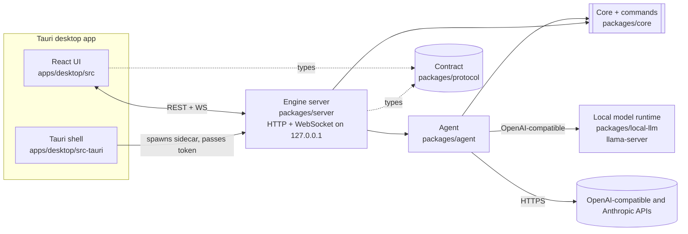

# Product v1 specification

Goal: a free desktop video editor with **chat on the left and the video on the right**, that works **with or without AI**. Every edit can be made by hand (timeline, drag and drop) or by asking. AI comes from (a) a small open model embedded in the app, (b) the user's own API key, or (c) the user's already signed-in command-line agent.

## How the pieces fit



**One command registry** (`COMMANDS` in `@dax/core`, see `packages/core/src/commands.ts`) is the only way a project changes: the UI's buttons, the built-in AI, external agents (MCP) and the CLI all call the same commands with the same validation and the same history. Do not add a second way to edit.

The shared contract is `@dax/protocol` (`packages/protocol/src/index.ts`): request, response and event types and the URL paths. Both server and UI import it; if a shape needs to change, change it there and fix both sides.

## Rules for everyone building a package

1. Read `/AGENTS.md` and `docs/engineering/coding-standards.md`. Every export has TSDoc; every file starts with a purpose comment; tests with every feature; no network in default tests (use a local mock server); no committed media (generate with FFmpeg `lavfi`).
2. Work only inside your own package directory. Do not edit `packages/core` or `packages/protocol`; if you need a change there, say so in your final report (the lead decides) or work around it.
3. Per-package checks: `pnpm --filter <pkg> build`, `test`, `docs:check`, and `pnpm exec biome check --write <your dir>`. Add a `typedoc.json` like `packages/evals/typedoc.json` and an entry for your workspace in `knip.json`.
4. Install dependencies with `flock /tmp/claude-0/pnpm.lock pnpm install` (parallel installs corrupt the lockfile). Prefer few, permissive-licence dependencies (MIT/Apache/BSD/ISC) and justify each in your report.
5. Commit on your own branch with Conventional Commits. Do not push.
6. Security basics: bind 127.0.0.1 only; never log secrets; validate every input with zod; never build shell strings; never pass user text to FFmpeg except through files or validated arguments.
7. Finish with a short **work summary** for the knowledge base: what you built, decisions, how to run/test it, what is missing or risky.

## packages/agent (`@dax/agent`)

Turns a chat message into edits by calling commands, for any model.

- `AgentProvider` interface: one model round trip: `chat({system, messages, tools, signal}) -> {text, toolCalls[], usage?, stopReason}`. Providers: **OpenAI-compatible** (`POST {baseUrl}/chat/completions` with `tools`; covers llama.cpp `llama-server`, Ollama, LM Studio, OpenAI, OpenRouter, Gemini's compatibility endpoint) and **Anthropic** (`POST /v1/messages` with `tool_use`). Use plain `fetch`; no vendor SDKs. Optional text streaming.
- `createAgent({provider, tools, ...}).run(message, {session, history, onEvent, signal, allowedRoots})` runs the loop (default max 8 turns): call model, validate and run each tool call via `tryRunCommand` (source `ai`), feed results or errors back, stop when the model answers without tool calls. Emits `AgentEvent`s from `@dax/protocol`. Cancel with `AbortSignal`.
- **Small-model reliability** is the main design goal: compact tool descriptions mode for local models; JSON repair (trailing commas, single quotes, code fences); accept tool calls written as text (`<tool_call>{...}</tool_call>` or a fenced JSON block) when a model does not use the native field; clear error messages returned to the model; detect a repeated identical failing call and stop; cap tool calls per turn; a system prompt that says: call `get_project` first, times are seconds, prefer high-level commands (`remove_silences`), never claim success without a tool result, ask one short question if the request is ambiguous, keep replies brief.
- Irreversible commands (`export_video`) are excluded unless `allowIrreversible` is set.
- A hook `contextProvider(message) -> string` lets the lead inject relevant *skills* (docs from `skills/`) without the agent knowing where they come from.
- Add a `ModelAdapter` (`packages/evals`) built on the agent so `pnpm eval --adapter openai --base-url ... --model ...` scores any OpenAI-compatible model on the eval tasks, and `--adapter anthropic`.
- Tests: scripted mock HTTP servers for both APIs; loop behaviours (error feedback, cancellation, max turns, text-embedded tool calls, repeated failure); an end-to-end test that drives the real core `Session` and real FFmpeg fixture with a scripted provider and passes the eval tasks.

## packages/local-llm (`@dax/local-llm`)

Manages the embedded open-weight model. Read `docs/research/embedded-local-llm.md` (if it exists yet) and `docs/evals/model-evaluation-plan.md`.

- `detectHardware()`; `MODEL_CATALOG` and `recommendModel(hardware)` by RAM tier (verified Hugging Face URLs, sizes, licences, context, tool-calling notes; check each URL with a HEAD request before listing it).
- `downloadFile(url, dest, {onProgress, signal, sha256})`: resumable with HTTP Range, atomic rename, disk-space check, progress events.
- `ensureRuntime()`: download the right llama.cpp release asset for the OS/arch into the app data dir, verify hash where published, extract it.
- `LlamaServer`: spawn `llama-server --jinja --host 127.0.0.1 --port <free> -m <model> -c <ctx>`, wait for health, expose an OpenAI-compatible `baseUrl`, stop cleanly, never leave an orphan (kill on parent exit), keep a log ring buffer, detect crashes.
- `LocalModelManager`: `status() / install(modelId) / start() / stop() / uninstall()`, with progress callbacks, so the server can show "Download model (2.1 GB)" in the UI.
- **Prove it for real in this sandbox** (4 CPUs, 15 GB RAM, no GPU; Hugging Face and PyPI and apt are reachable; GitHub release downloads may or may not be): get a working `llama-server` (release asset, build from source with cmake, or another route) and a small tool-capable GGUF, run a real chat completion with a tool call, and record timings. Network tests are opt-in via `DAX_LIVE_TESTS=1` and are not part of default test runs.

## packages/server (`@dax/server`)

Local HTTP + WebSocket API over the engine. Implements `@dax/protocol` exactly.

- Node `http` + `ws` (MIT). No big framework.
- **Auth:** random per-launch token; `Authorization: Bearer` for API calls, `?token=` for media URLs. Bind `127.0.0.1`. Validate the `Host` header (reject others) and `Origin` against an allow-list given by `--origin` flags (the Vite dev origin, `tauri://localhost`, `http://tauri.localhost`). No CORS for anyone else. Body size limit. Never serve files outside the data dir except via asset ids.
- **State:** one open project (`Session` backed by a file under the data dir), project manager (new/open/save), settings and secrets files (`settings.json`; `secrets.json` with 0600 permissions; keys never returned, never in project files).
- **Commands:** `POST /api/command` runs a registry command with `source: manual`, allowed roots from `--allow-root` flags (default: the user's home and the data dir); every change broadcasts a `state` event over the WebSocket.
- **Media pipeline:** on import, queue jobs (reported as `job` events) producing per asset: a 480p proxy MP4 (short keyframe interval so seeking is quick, AAC audio, encoder chosen with `chooseEncoder`), thumbnails, waveform peaks, filmstrip. Serve with **HTTP Range** support. Cache under the data dir.
- **Export:** `export_video` command wrapped in a job with progress events.
- **Chat:** `POST /api/chat` starts a run through an injected `AgentRunner` (`run(message, {session, onEvent, signal}) -> Promise<void>`) chosen from the active provider; events stream as `chat` messages; `POST /api/chat/cancel`. Provider status and settings endpoints. The default runner wiring to `@dax/agent` and `@dax/local-llm` is done by the lead after merge, so the server must work with an injected `ScriptedRunner` in tests.
- `dax-server` executable: `node dist/cli.js --port 0 --data-dir <dir> --origin <o> --allow-root <p>`; prints one JSON line (`ServerInfo`) to stdout when ready; exits on SIGTERM and when its parent process disappears (stdin closing).
- Tests: real HTTP against a temp data dir and FFmpeg-generated media; auth (401, bad Host 403, bad Origin), path traversal, Range requests, command round trip, WebSocket state events, job progress, import outside allowed roots refused.

## apps/desktop UI (`apps/desktop/src`)

React 18 + TypeScript + Vite. Light dependencies (React, one small state library, a test stack). No UI kit that needs a paid licence. Dark theme by default. See `docs/research/timeline-ui-patterns.md` (if present) for researched patterns.

- **Layout:** left = chat panel (resizable); right = preview on top, timeline below; top bar with project name, Import, Export, Undo/Redo, History, Settings. A media bin and a Presets panel are tabs on the right or a side drawer.
- **Works without AI.** Every feature below is usable by hand; the chat panel shows a setup card when no provider is configured.
- **Preview:** plays the *edit*, not a file: sequential proxy clips with correct trims, volume and fades, with text overlays drawn as DOM/CSS that approximate each preset's animation. Play/pause, scrub, frame step, loop. Keep audio in sync.
- **Timeline:** ruler with zoom, draggable playhead; clip blocks showing thumbnails and waveform; drag to reorder (`move_clip`); drag edges to trim (`trim_clip`); split at playhead (`S`); delete (`Delete`, ripple); fade handles; an overlay lane where overlay blocks can be moved and resized; snapping to clip edges and the playhead.
- **Presets panel:** the built-in animated text presets (from `state.presets`); **drag one onto the timeline** to add it at that time (`add_overlay`). Selecting an overlay opens an inspector (text, subtitle, animation, colour, size, position, duration).
- **History:** panel listing every state with its label and who made it (manual / AI / template); click to restore (`restore_state`); named checkpoints; Undo/Redo buttons and `Ctrl/Cmd+Z`, `Shift+Ctrl/Cmd+Z`.
- **Chat:** streaming transcript from `chat` events; tool calls shown as compact steps with a check or cross; an **Undo this change** button after an AI run; suggestion chips ("Remove silences", "Add a title", "Cut to 30 seconds"); cancel button; provider selector (Local model, API key, CLI sign-in) with status from `state.providers`.
- **Settings:** provider choice and fields (base URL, model, API key box that never shows the key again); local model card with download/start/stop/cancel/remove and progress. The API is `GET /api/local-model` (status) plus `POST /api/local-model/install|start|stop|cancel|uninstall`; its shapes are in `@dax/protocol` and the server is the source of truth.
- **Platform layer** (`src/platform.ts`): `pickFiles()`, `onFileDrop()`, `getServerInfo()`. Web build reads `?server=&token=` and offers a typed-path box for importing; the Tauri build uses the native dialog, drag-and-drop paths and a `get_server_info` command. Keep Tauri imports lazy so the web build works without them.
- **Testing:** component tests (Vitest + Testing Library) and Playwright end-to-end tests using the preinstalled Chromium (`PLAYWRIGHT_BROWSERS_PATH=/opt/pw-browsers`; launch with `executablePath: '/opt/pw-browsers/chromium'` if needed) against the **real `@dax/server`** run in-process by `apps/desktop/e2e/mock-server.mjs` (only the assistant, the local model and CLI sign-in are faked, through the server's own interfaces), plus `e2e/real-engine.spec.ts`, which starts the real `dax-engine` process with nothing faked. A hand-written stand-in for the API is not used: it drifted from the server once. Take screenshots and look at them; fix what looks wrong.
- Accessibility basics: keyboard operable, labelled controls, visible focus.

### UI split: two builders, one interface

The UI is built in parallel by two builders who must agree on this interface exactly.

- **App shell builder** owns `apps/desktop/src/app/**`, `src/api/**`, `src/platform.ts`, `src/main.tsx`, `index.html`, the Vite and test config, and `apps/desktop/e2e/mock-server.mjs`. It builds: top bar, chat panel, settings, media bin, history panel, the API client (REST + WebSocket reconnect), first-run empty state, the platform layer, and it composes the editor module into the layout. It implements `EditorApi` below.
- **Editor builder** owns `apps/desktop/src/editor/**`. It builds the preview player, timeline, presets panel, inspector and editor toolbar, plus the editor's own state (playhead, selection, zoom, playback). It consumes `EditorApi`.

```ts
// apps/desktop/src/editor/types.ts (written by the editor builder, imported by the app shell)
import type { CommandResponse, StateResponse } from "@dax/protocol";

/** What the editor needs from the rest of the app. Implemented by the app shell. */
export interface EditorApi {
  /** Latest server state; replaced whenever the server pushes a `state` event. */
  state: StateResponse;
  /** Base URL and token, used with `mediaUrl()` from @dax/protocol to build media URLs. */
  serverUrl: string;
  token: string;
  /** Run a registry command via POST /api/command. Never throws: failures come back as { ok: false }. */
  run(name: string, args?: Record<string, unknown>): Promise<CommandResponse>;
}

/** Editor-owned UI state, available to the app shell through useEditor(). */
export interface EditorUi {
  playhead: number; // seconds on the timeline
  setPlayhead(seconds: number): void;
  playing: boolean;
  setPlaying(playing: boolean): void;
  selection: { kind: "clip" | "overlay"; id: string } | null;
  select(selection: { kind: "clip" | "overlay"; id: string } | null): void;
  zoom: number; // pixels per second
  setZoom(pixelsPerSecond: number): void;
}
```

The editor module's public surface (`apps/desktop/src/editor/index.ts`): `EditorProvider({ api, children })`, `useEditor(): EditorApi & EditorUi`, and the components `PreviewPane`, `Timeline`, `PresetsPanel`, `Inspector`, `EditorToolbar`, plus `useEditorShortcuts()`. The app shell places `PreviewPane` over `Timeline` on the right, `PresetsPanel` / `Inspector` / media bin / history in a side drawer or tabs, and the chat on the left. Each builder writes its own tests with a small fake `EditorApi`/mock server so neither blocks on the other; the lead merges the two and runs the combined end-to-end tests.

## apps/desktop shell (`apps/desktop/src-tauri`)

Tauri 2. Read `docs/research/tauri-sidecar-packaging.md` (if present). Linux build libraries are installed in the sandbox, `xvfb-run` is available, and crates.io is reachable.

- Launch the engine server as a sidecar with a random token, parse its `ServerInfo` line, expose it to the UI through a `get_server_info` command, and kill it when the window closes or the app exits (no orphans, even on crash).
- Native open-file dialog (plugin-dialog) and file drag-and-drop giving real paths; window config; capabilities with least privilege (no broad shell or fs access).
- Dev and build scripts (`pnpm dev:desktop`, `pnpm build:desktop`), a placeholder icon set generated with `tauri icon`, bundle config for macOS/Windows/Linux, and a CI/release workflow that builds all three (not run here). Smoke test the Linux build under `xvfb-run` and record what you verified.
- Honest about what cannot be tested here (macOS, Windows, code signing).

## Later (not in the first build)

Cut engine with reviewable cut plans, skills layer (`skills/`), industry and creator-style templates, plugin system and open-source integrations, whisper.cpp transcription, MCP server and CLI bridges to Claude Code / Codex / Gemini CLI. Research for each lives in `docs/research/`.
